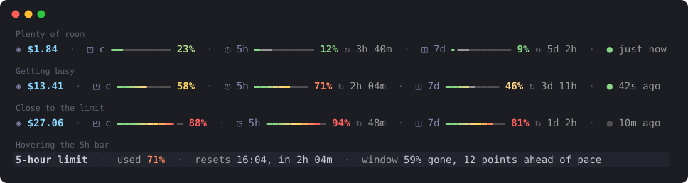

# Usage Bar: see your Claude Code usage limits, context and cost at a glance

**Usage Bar** is a [Claude Code](https://code.claude.com) plugin that shows your **5-hour and weekly usage limits**, your **context window usage** and your **session cost** as colour-graded bars just above the prompt. You can see how close you are to a Claude Pro or Max limit, and when it resets, without running `/usage`.



```
/plugin install usage-bar --marketplace overvac/usage-bar
```

Type that at the Claude Code prompt and you're done. Nothing to configure, it doesn't touch your settings, and it uses no tokens.

## Features

- **5-hour and weekly (7-day) limit bars** for Claude Pro and Max plans, each with a countdown to its reset: `◷ 5h ━━━━━━━╸━━━ 71% ↻ 2h 04m`
- **Context window bar**, so you can see when a conversation is close to auto-compacting.
- **Session cost** in US dollars.
- **Colour-graded bars** that fade from green through amber to red as they fill. The percentage takes the colour of the point the bar has reached.
- **"Last updated" indicator** showing how long ago any of the numbers last changed (`● 42s ago`).
- **Fits the window:** the bars stretch on wide terminals and shrink on narrow ones. On very narrow ones only the numbers are shown.
- **Live countdowns** that keep ticking while Claude Code is idle.
- **Keeps your status line.** Usage Bar draws its own row above the prompt, so a custom status line you already have stays as it is.
- **Works in the terminal and the Claude desktop app.**
- **`/usage-bar`** hides it and shows it again. The choice is remembered across sessions.

## Install

Requires a recent version of Claude Code with plugin mod support (tested on 2.1.301).

**At the Claude Code prompt:**

```
/plugin install usage-bar --marketplace overvac/usage-bar
```

Answer `y` to add the marketplace, then press Enter to install for your user. The bar appears as soon as Claude Code has numbers to show: the cost and context after your first message, and the limits once your plan reports them.

**From a shell:**

```bash
claude plugin install usage-bar --marketplace overvac/usage-bar
```

**In the Claude desktop app:** click **+** next to the prompt box, then **Plugins**, then **Add marketplace**, and enter `overvac/usage-bar`. Then choose **Add plugin**.

**Update:** run `claude plugin update usage-bar`, or use the `/plugin` menu.

**Uninstall:** `/plugin uninstall usage-bar`, or `claude plugin uninstall usage-bar` from a shell.

## What each part means

| Segment | Meaning |
|---|---|
| `$13.41` | Estimated cost of the current session in US dollars, as Claude Code totals it. It resets on `/clear`. |
| `◔ ctx ━━━━━ 58%` | How full the context window is. Near 100%, Claude Code compacts the conversation. |
| `◷ 5h ━━━━━ 71% ↻ 2h 04m` | Share of your rolling 5-hour usage limit used, and the time until it resets. |
| `◫ 7d ━━━━━ 46% ↻ 3d 11h` | Share of your weekly (7-day) usage limit used, and the time until it resets. |
| `● 42s ago` | Time since any of the numbers above last changed. The dot is green for the first minute. |

Segments with no data are hidden.

## FAQ

### Does Usage Bar use tokens or make API calls?

No. Claude Code already tracks these numbers and hands them to the plugin whenever they change. Usage Bar only draws them, so it costs nothing and doesn't count towards your usage limits.

### Why don't the 5-hour and weekly bars show up?

Claude Code only has usage limit data for **Claude Pro and Max subscribers** signed in with their claude.ai account, and only after the first response in a session. If you use Claude Code with an API key, you'll see the cost and context bars but not the limit bars.

### How accurate is the cost?

It's the estimate Claude Code calculates itself, at list prices. It may differ from your actual bill. On a Pro or Max subscription you don't pay per token, so treat it as a measure of how heavy the session is.

### Will it replace my status line?

No. Usage Bar is a plugin that draws its own row above the prompt. Your `statusLine` setting, and any status line script, keep working.

### How do I hide it?

Run `/usage-bar`. Run it again to bring the bar back.

### I'd rather have it as a classic status line

[claude-usage-bar](https://github.com/overvac/claude-usage-bar) is the same bar as a `statusLine` script, installed with one `curl` command.

## Development

The plugin is a Claude Code mod: `hooks/register.tsx` is the whole thing, and `types/index.d.ts` declares the state it keeps. To work on it:

```bash
git clone https://github.com/overvac/usage-bar.git
claude --plugin-dir ./usage-bar     # run Claude Code with your working copy
claude plugin validate ./usage-bar  # check the manifest and module
claude plugin test ./usage-bar      # run the tests in tests/
```

## License

[MIT](LICENSE)

Usage Bar is a community project and is not affiliated with or endorsed by Anthropic. Claude and Claude Code are trademarks of Anthropic.
