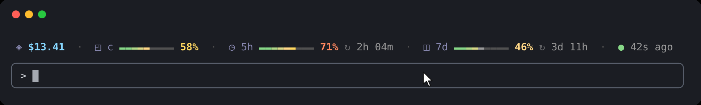

# Usage Bar: Claude Code usage limits, context and cost at a glance

**Usage Bar** is a [Claude Code](https://code.claude.com) plugin that shows your **5-hour and weekly usage limits**, **context window** and **session cost** as colour-graded bars above the prompt. You can see how close you are to a Claude Pro or Max limit, and when it resets, without running `/usage`.



```
/plugin install usage-bar --marketplace overvac/usage-bar
```

## Features

- **5-hour and weekly limit bars** for Pro and Max plans, with live reset countdowns.
- **Pace:** the empty part of each limit bar is lighter up to where even use of the window would be, so you can see when you're using a limit faster than it allows.
- **Context window bar** and **session cost**.
- **Hover a metric** for its details in the bar's own row: token counts, the exact reset time, how far ahead of or behind pace you are.
- **Colour-graded bars** that run green → amber → red, and a brief highlight when a number changes.
- **Fits any width:** bars share the free space; on narrow terminals only the numbers show.
- **Doesn't touch your status line**, and works in the terminal and the Claude desktop app's Code tab.

## Install

Requires a recent Claude Code with plugin mod support (tested on 2.1.301).

| Where | How |
|---|---|
| Claude Code prompt | `/plugin install usage-bar --marketplace overvac/usage-bar`, then `y` to add the marketplace and Enter to install |
| Shell | `claude plugin install usage-bar --marketplace overvac/usage-bar` |
| Claude desktop app | **+** next to the prompt box → **Plugins** → **Add marketplace** → `overvac/usage-bar` → **Add plugin** |

The bar appears once Claude Code has numbers to show, after your first message. Update with `claude plugin update usage-bar`; remove with `/plugin uninstall usage-bar`.

## Reading the bar

```
◈ $13.41  ·  ◰ c ━━━━━━╸━━━━━ 58%  ·  ◷ 5h ━━━━━━━━╸━━━ 71% ↻ 2h 04m  ·  ◫ 7d ━━━━━━━━━━━ 46% ↻ 3d 11h  ·  ● 42s ago
```

| Segment | Meaning |
|---|---|
| `◈ $13.41` | Estimated session cost in US dollars, at list prices. Resets on `/clear`. |
| `◰ c` | How full the context window is. Claude Code compacts the conversation near 100%. |
| `◷ 5h` | Share of your rolling 5-hour limit used, and time until it resets. |
| `◫ 7d` | Share of your weekly limit used, and time until it resets. |
| `● 42s ago` | Time since any figure last changed. |

## Settings

Open `/config` and type `usage`. Every metric and the pace shading can be switched off; the remaining bars take the freed space. `/usage-bar` hides or shows the whole bar, and the choice is remembered.

| Setting | Default |
|---|---|
| Show session cost · context window · 5-hour limit · weekly limit · last change | on |
| Show pace on limit bars | on |

## Privacy and safety

The whole plugin is one readable file, [`hooks/register.tsx`](hooks/register.tsx), and runs only through Claude Code's plugin API. It reads the usage figures Claude Code already tracks and your `theme` setting, and stores a single value: whether the bar is hidden. It **makes no network requests, reads or writes no files, runs no commands, uses no tokens** and sends nothing to the model. `claude plugin validate` lists every call it makes.

## FAQ

**Why don't the 5-hour and weekly bars show?** Claude Code only reports usage limits for **Claude Pro and Max** subscribers signed in with claude.ai, and only after the session's first response. With an API key you get the cost and context bars.

**Does it replace my status line?** No. It draws its own row above the prompt, so a custom `statusLine` keeps working.

**How accurate is the cost?** It's Claude Code's own estimate at list prices and may differ from your bill. On Pro or Max, treat it as a measure of how heavy the session is.

## Development

```bash
git clone https://github.com/overvac/usage-bar.git
claude --plugin-dir ./usage-bar     # run Claude Code with your working copy
claude plugin validate ./usage-bar  # check the manifest and module
claude plugin test ./usage-bar      # run the tests
```

## License

[MIT](LICENSE). Usage Bar is a community project, not affiliated with or endorsed by Anthropic. Claude and Claude Code are trademarks of Anthropic.
